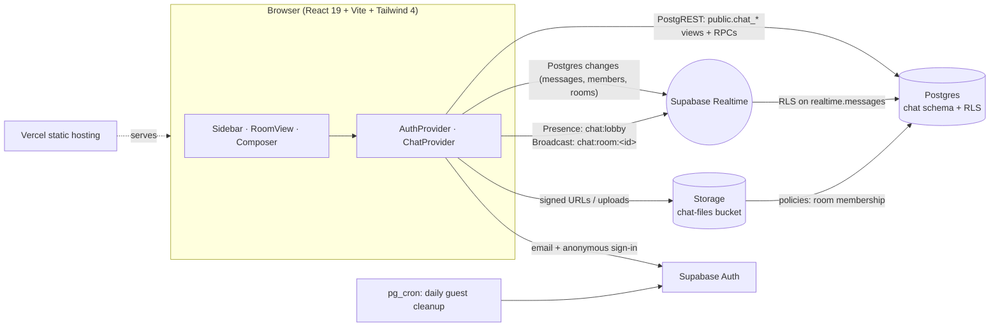

# Aerogram ✉️

**Real-time chat, styled like airmail.** Public rooms and 1:1 direct letters with live delivery, presence, typing indicators, read receipts, reactions and file sharing. Built on React and Supabase.

- **Live app:** https://aerogram-ten.vercel.app
- **Guest demo (no sign-up):** https://aerogram-ten.vercel.app/demo


## Features

| | |
| --- | --- |
| **Accounts** | Email sign-up / sign-in with Supabase Auth, plus a one-click **guest pass** at `/demo` (anonymous sign-in; guests and their files are removed automatically after a day). |
| **Rooms & DMs** | Seeded public rooms with a cast of friendly regulars, create or browse/join public rooms, leave them, and start 1:1 direct letters with anyone. **Pip**, the concierge bot, answers DMs instantly with canned tips (no AI). |
| **Live delivery** | New, edited and withdrawn messages arrive over Supabase Realtime (Postgres changes, filtered by RLS). |
| **Presence** | Who's online across Aerogram (Realtime Presence on a private channel), shown as green dots and per-room online counts. |
| **Typing** | "Hana is writing…" via Realtime Broadcast on a private per-room channel, throttled and auto-expiring. |
| **Read receipts & unread** | Per-member read markers: "Read ✓" in DMs, "Seen by N" stamps in rooms, wax-seal unread badges and an unread count in the tab title. |
| **Reactions, edit, delete** | Emoji reactions with who-reacted tooltips, inline edit (marked *edited*), and soft delete ("withdrawn") that also removes the attachment. |
| **Files** | Images and files (PNG, JPEG, WebP, GIF, PDF, TXT, CSV, MD, ZIP, JSON; up to 5 MB) via attach, paste or drag-and-drop, stored in a private bucket and served with short-lived signed URLs. |
| **Feels fast** | Optimistic sends with retry/discard on failure, infinite scroll back through history with scroll anchoring, a "new letters" jump button. |
| **Everywhere** | Responsive list/room layout for phones, light (**Airmail**) and dark (**Night Mail**) themes, styled tooltips on every button, pressed-state feedback on every control, keyboard friendly and axe-checked. |

## Design

Aerogram borrows from the airmail envelope: cream paper, red-and-blue chevron borders, perforated postage stamps for avatars and rooms, circular postmarks for day dividers, and wax-seal unread badges. Type is **Fraunces** (display), **Public Sans** (UI) and **IBM Plex Mono** (timestamps and labels). Night Mail swaps the paper for a deep navy envelope with the same accents.

## Architecture



- **No server code.** The SPA talks straight to Supabase; every rule lives in Postgres.
- **Data API surface.** The `chat` schema is not exposed directly; the client uses `security_invoker` views (`public.chat_messages`, `chat_members`, `chat_rooms`, `chat_profiles`) so RLS still applies, plus a few `SECURITY DEFINER` RPCs for multi-row operations (`chat_my_rooms`, `chat_public_rooms`, `chat_create_room`, `chat_open_dm`, `chat_toggle_reaction`, `chat_ensure_profile`).
- **Realtime.** One Postgres-changes channel per user (RLS decides what each user receives), one private presence channel for the whole app, and one private broadcast channel per open room for typing.

## Schema & security notes

Tables: `chat.profiles`, `chat.rooms` (`public` or `dm`), `chat.members` (with `last_read_at`), `chat.messages` (body, JSON attachment, `reactions`, `edited_at`, `deleted_at`).

- **Members only.** Messages and members are readable only by members of the room; public rooms are listed to every signed-in user, but their messages need a membership row (joining inserts one).
- **Authorship.** You can only post as yourself, only edit or withdraw your own messages, and only update your own membership row (read marker). A trigger blocks changes to anything but the body/reaction fields and validates attachments (path must be `<room>/<you>/…`).
- **Abuse limits.** 12 messages per 20 s per user, 4,000-character bodies, guests capped at 400 messages, 3 rooms and 10 DMs; accounts at 20 rooms and 200 DMs.
- **Realtime authorization.** RLS on `realtime.messages` lets you join `chat:lobby` when signed in and `chat:room:<id>` only if you are a member of that room.
- **Storage.** Private `chat-files` bucket, 5 MB limit and a MIME allow-list. Policies: read if you are a member of the room in the path, upload only into `<room>/<your id>/` of a room you belong to, delete only your own files.
- **Guest cleanup.** Anonymous users older than a day are deleted by a scheduled job; their profile, memberships and messages cascade, and their files are purged.

The full migration is in [`supabase/migrations`](supabase/migrations).

## Stack

React 19 · TypeScript · Vite · Tailwind CSS 4 · Supabase (Auth, Postgres, Realtime, Storage) · lucide-react · Vitest · Playwright + axe · GitHub Actions · Vercel.

## Run it locally

```bash
git clone https://github.com/JoshuaMColon/aerogram && cd aerogram
npm install
cp .env.example .env.local   # fill in your project URL and publishable/anon key
npm run dev
```

To use your own Supabase project, run the migration in `supabase/migrations` (SQL editor or `supabase db push`), enable **anonymous sign-ins** for the guest demo, and add `http://localhost:5173/**` and your deployed URL to the Auth redirect list.

Without env vars the app still builds; the landing and sign-in pages render and explain that no backend is configured.

## Tests

```bash
npm run typecheck && npm run lint
npm test            # Vitest: merge/grouping, receipts, unread, typing expiry, file validation
npm run test:e2e    # Playwright + axe on landing/sign-in (light, dark, mobile), tooltips, theme
BASE_URL=https://aerogram-ten.vercel.app npm run test:live   # two real guest sessions: presence, typing, message, read receipt
```

CI runs typecheck, lint, unit tests, build and the Playwright/axe suite on every push and pull request.

## License

MIT
