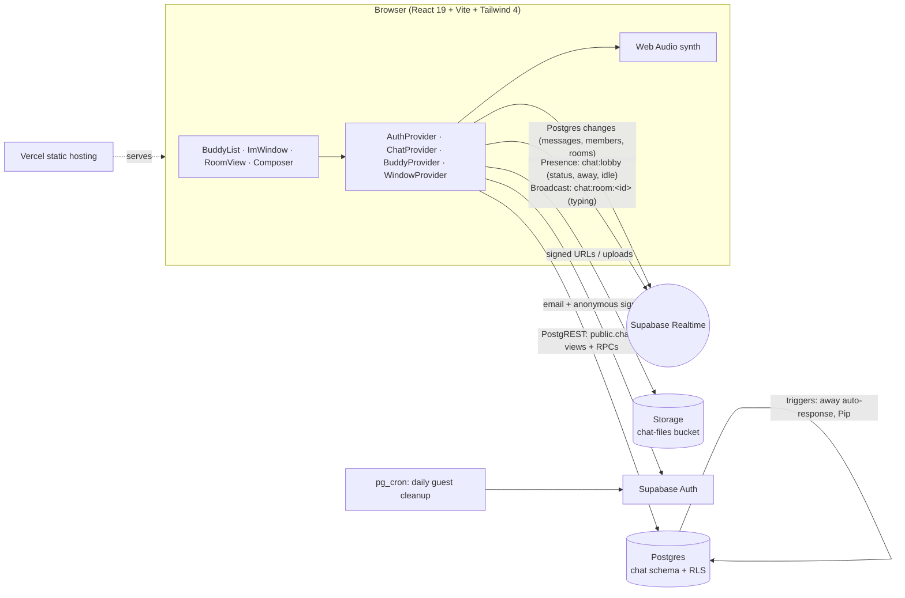

# Buddyline 💬

**Instant messaging, the way you remember it.** A modern take on the early-2000s buddy-list messenger: a Buddy List home with groups and away messages, floating IM windows, door-open sign-on chimes and a window-shaking Buzz, all running live on React and Supabase.

> Buddyline is an original design. It is not affiliated with, and uses no names, logos, artwork or sounds from, any classic messenger. Every sound is synthesized in the browser with the Web Audio API.

- **Live app:** https://aerogram-ten.vercel.app
- **Guest demo (no sign-up):** https://aerogram-ten.vercel.app/demo

The repo and Vercel project keep their original `aerogram` names (and URLs) so existing links and deployments keep working.


## Features

|                             |                                                                                                                                                                                                                                                                                                                                                      |
| --------------------------- | ---------------------------------------------------------------------------------------------------------------------------------------------------------------------------------------------------------------------------------------------------------------------------------------------------------------------------------------------------- |
| **Screen names**            | Pick a screen name on sign-up (3–20 letters, numbers, spaces, `_ . -`, unique ignoring case). Guests at `/demo` get a generated one like `xXSkaterHeronXx` or `sk8r_finch98`. Profiles carry a buddy icon and a short bio.                                                                                                                           |
| **Buddy List**              | The home screen. Collapsible groups (**Buddies**, **Family**, **Co-Workers**, plus your own), each with an online/total count, and an **Offline** section. Add buddies by screen name, remove them, rename or delete groups, and move buddies by drag-and-drop or the ⋯ menu. Hover a buddy for their away message, bio or status.                   |
| **Presence**                | Available, Away and Idle (after 5 minutes without input, shown as "Idle 12m"), plus "last seen" for offline buddies. Status lives in Postgres (`chat.profiles`) and is mirrored live over Realtime Presence.                                                                                                                                         |
| **Away messages**           | Set a custom away message or pick a preset (with fun defaults; your custom ones are saved). It shows under your name, in hover cards and in IM headers, and anyone who IMs you while you are away gets **one** automatic "Auto response from …" per away spell, sent by the database. `%n` and `%t` expand to the reader's screen name and the time. |
| **IM windows**              | On desktop, IMs and chat rooms open as floating windows you can drag, resize, stack, minimize to a taskbar and restore (they remember where you left them). Incoming IMs pop a window without stealing focus. On phones they become full-screen tabs.                                                                                                |
| **Buzz**                    | Shake your buddy's IM window (and play a buzz) with a short cooldown. Reduced-motion users get a highlight instead of a shake.                                                                                                                                                                                                                       |
| **Typing**                  | The classic pair: "Hana is typing..." while keys are moving and "Hana has entered text." when they pause with a draft.                                                                                                                                                                                                                               |
| **Sign-on toasts & sounds** | Buddies signing on or off show a toast with a door-open or door-close chime. All sounds (door open/close, message blip, buzz) are synthesized with Web Audio; a mute toggle sits in the Buddy List footer (on by default; the choice is remembered).                                                                                                 |
| **Formatting & smileys**    | Bold, italic, underline, seven colors and three sizes per message (stored as a sanitized style object, never raw HTML), plus classic text smileys like `:-)` `;-)` `:-P` `B-)` rendered as original icons.                                                                                                                                           |
| **Still a real chat app**   | Public chat rooms, DMs, read receipts, reactions, edit and delete, file sharing (images, PDF, text, ZIP; 5 MB), optimistic sends with retry, infinite history and Pip, the canned-reply bot (no AI).                                                                                                                                                 |
| **Everywhere**              | Light (**Daydream**, Y2K pastel chrome) and dark (**Midnight**) themes, tooltips on every button, pressed-state feedback on every control, keyboard friendly and axe-checked.                                                                                                                                                                        |

## Design

Glossy early-2000s window chrome, redrawn cleanly: gel title bars, pill buttons, a pastel desktop "wall" and a taskbar. Type is **Nunito** for the UI with a pixel accent font for labels. Midnight swaps the pastels for deep violet glass with the same accents. Nothing is copied from any real messenger: the logo, icons and smileys are original SVG, and the sounds are generated at runtime.

## Architecture



- **No server code.** The SPA talks straight to Supabase; every rule lives in Postgres.
- **Data API surface.** The `chat` schema is not exposed directly; the client uses `security_invoker` views (`public.chat_messages`, `chat_members`, `chat_rooms`, `chat_profiles`) so RLS still applies, plus `SECURITY DEFINER` RPCs for multi-row work: rooms and DMs (`chat_my_rooms`, `chat_public_rooms`, `chat_create_room`, `chat_open_dm`, `chat_toggle_reaction`, `chat_ensure_profile`) and the buddy list (`chat_buddy_list`, `chat_add_buddy`, `chat_remove_buddy`, `chat_move_buddy`, `chat_save_group`, `chat_delete_group`, `chat_set_presence`, `chat_away_presets`, `chat_save_away_presets`).
- **Realtime.** One Postgres-changes channel per user (RLS decides what each user receives), one private presence channel for the whole app carrying status, away message and idle time, and one private broadcast channel per open window for typing.

## Schema & security notes

Tables: `chat.profiles` (screen name, icon, bio, status, away message, idle and last-seen times, saved away presets), `chat.rooms` (`public` or `dm`), `chat.members` (with `last_read_at`), `chat.messages` (body, JSON attachment, `reactions`, `style`, `kind` = `text` / `buzz` / `away`, `edited_at`, `deleted_at`), `chat.buddy_groups` and `chat.buddies` (each user's own list), and `chat.away_replies` (internal: one auto response per sender per away spell).

- **Your list is yours.** Buddy groups and buddies are readable and writable only by their owner (RLS on `owner = auth.uid()`); adding a buddy needs their exact screen name.
- **Status is yours.** Only you can change your status, away message or idle flag (via `chat_set_presence`); a trigger blocks direct edits to those columns and validates screen names.
- **Auto responses and Buzz.** Away auto responses are written by a database trigger, never by the client; clients may only send `text` or `buzz` messages, buzzes are DM-only and rate-limited, and formatting is reduced to a fixed allow-list.

- **Members only.** Messages and members are readable only by members of the room; public rooms are listed to every signed-in user, but their messages need a membership row (joining inserts one).
- **Authorship.** You can only post as yourself, only edit or withdraw your own messages, and only update your own membership row (read marker). A trigger blocks changes to anything but the body/reaction fields and validates attachments (path must be `<room>/<you>/…`).
- **Abuse limits.** 12 messages per 20 s per user, 4,000-character bodies, guests capped at 400 messages, 3 rooms and 10 DMs; accounts at 20 rooms and 200 DMs.
- **Realtime authorization.** RLS on `realtime.messages` lets you join `chat:lobby` when signed in and `chat:room:<id>` only if you are a member of that room.
- **Storage.** Private `chat-files` bucket, 5 MB limit and a MIME allow-list. Policies: read if you are a member of the room in the path, upload only into `<room>/<your id>/` of a room you belong to, delete only your own files.
- **Guest cleanup.** Anonymous users older than a day are deleted by a scheduled job; their profile, memberships and messages cascade, and their files are purged.

The migrations are in [`supabase/migrations`](supabase/migrations).

## Stack

React 19 · TypeScript · Vite · Tailwind CSS 4 · Supabase (Auth, Postgres, Realtime, Storage) · lucide-react · Vitest · Playwright + axe · GitHub Actions · Vercel.

## Run it locally

```bash
git clone https://github.com/JoshuaMColon/aerogram buddyline && cd buddyline
npm install
cp .env.example .env.local   # fill in your project URL and publishable/anon key
npm run dev
```

To use your own Supabase project, run the migrations in `supabase/migrations` in order (SQL editor or `supabase db push`), enable **anonymous sign-ins** for the guest demo, and add `http://localhost:5173/**` and your deployed URL to the Auth redirect list.

Without env vars the app still builds; the landing and sign-in pages render and explain that no backend is configured.

## Tests

```bash
npm run typecheck && npm run lint
npm test            # Vitest: grouping, receipts, unread, files, screen names, buddy sections, idle/away text, smileys, window layout
npm run test:e2e    # Playwright + axe on landing/sign-in (light, dark, mobile), tooltips, theme
BASE_URL=https://aerogram-ten.vercel.app SHOTS_DIR=shots npm run test:live
# two real guest sessions: add buddy, sign-off/sign-on toasts, IM window auto-open, read receipt,
# "is typing..." / "has entered text.", away message + exactly one auto response, Buzz, theme, mobile.
# Prints the guest ids it created so you can delete them (they also expire after a day).
```

CI runs typecheck, lint, unit tests, build and the Playwright/axe suite on every push and pull request.

## License

MIT
